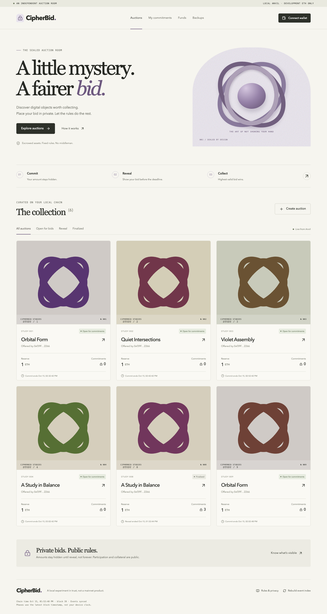
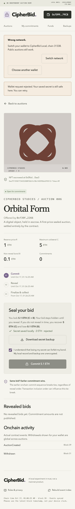
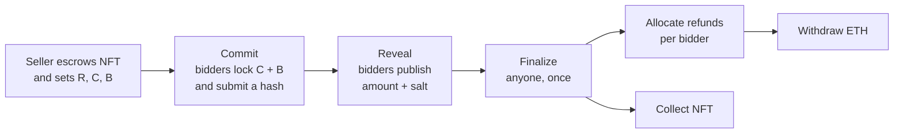

<div align="center">

# CipherBid

**A sealed-bid auction room for ERC-721 collectibles that runs entirely on your machine.**

Commit–reveal bidding · fixed collateral · deterministic settlement · pull-based withdrawals

[](https://docs.soliditylang.org/)
[](https://www.getfoundry.sh/)
[](https://react.dev/)
[](https://wagmi.sh/)
[](LICENSE)

</div>

> [!WARNING]
> **Development ETH only.** CipherBid runs on a local Anvil chain. It has not been independently audited, and it makes no claim of mainnet readiness.

<p align="center">
  
  &nbsp;
  
</p>

## Why CipherBid

In an open auction, everyone sees every bid. CipherBid runs a first-price sealed-bid auction instead:

- **Hidden bids.** You submit only a hash of your bid. The amount stays hidden until you reveal it, as long as your secret salt is generated securely.
- **Identical deposits.** Every bidder locks the same collateral C plus a bond B, so deposit sizes don't leak bids. The tradeoff: more capital is locked, and C is a public upper bound.
- **Rules enforced onchain.** The NFT is escrowed when the auction is created. Settlement is permissionless and deterministic, and no admin can seize escrow or bidder funds.
- **Pull-based payouts.** Refunds, proceeds, and NFTs are claimed separately, so a recipient that rejects a transfer can't block anyone else.
- **Secrets stay in your browser.** Reveal secrets live in IndexedDB with downloadable JSON backups. Nothing goes to a server, analytics, or the cloud.
- **Fully local.** No paid RPC, backend, API keys, or real cryptocurrency. After setup, everything works offline.

## How an auction works



The highest valid bid wins and pays its own bid. Equal bids go to whoever committed first onchain, regardless of reveal order, so transaction inclusion order can influence ties.

| Participant              | Gets back                                                                          |
| ------------------------ | ---------------------------------------------------------------------------------- |
| Winner                   | The NFT, plus C − winning bid + B as refundable credit                             |
| Other valid revealers    | C + B                                                                              |
| Bidders who don't reveal | C (the bond B goes to the seller)                                                  |
| Seller                   | The winning bid and any forfeited bonds, or the NFT back after no sale or a cancel |

## Quick start

### Prerequisites

- Node.js 22.12 or newer (tested with 22.22.0)
- pnpm 11.6.0, through Corepack or your package manager
- macOS or Linux, for the pinned Foundry npm binaries
- Internet for the first install and the Solidity compiler and Chromium downloads
- To bid in the browser: a disposable MetaMask, Rabby, or other wallet that supports custom networks. Phantom does not work ([see below](#phantom-shows-unsupported-network)). The terminal demo and automated tests need no wallet.

### Install

```sh
pnpm install --frozen-lockfile
pnpm contracts:build
pnpm exec playwright install chromium --no-shell
```

### Run

**Terminal 1** (leave it running):

```sh
pnpm chain
```

**Terminal 2:**

```sh
pnpm deploy:local
pnpm seed
pnpm dev
```

Open **http://127.0.0.1:5174**. Public auctions load without a wallet.

| Setting      | Value                   |
| ------------ | ----------------------- |
| Anvil RPC    | `http://127.0.0.1:8546` |
| Chain ID     | `31338`                 |
| Network name | CipherBid Local         |
| Currency     | ETH, development only   |
| Frontend     | `http://127.0.0.1:5174` |

Anvil binds only to loopback, with no mainnet fork and no saved state. Never expose its unlocked-account RPC to a network.

### Connect and fund a wallet

1. Click **Connect wallet** and choose MetaMask or Rabby. Click **Switch network**, then approve adding CipherBid Local.
2. Fund the wallet and mint yourself a collectible. Neither command needs a private key.

```sh
pnpm fund:local --address 0xYOUR_WALLET_ADDRESS   # sends 100 development ETH
pnpm mint:local --address 0xYOUR_WALLET_ADDRESS   # mints an NFT and prints its token ID
```

Seeded auctions belong to Anvil account 0. To sell your own NFT, open **Create auction** and enter the minted token ID. It takes two confirmations: approve, then create.

#### Phantom shows “Unsupported network”

Phantom can't add custom networks ([Phantom's documentation](https://help.phantom.com/hc/en-us/articles/46595961428627-Can-I-manually-add-a-network-to-Phantom)), so it can't reach the local chain. CipherBid lists each installed wallet separately and disables Phantom. If Phantom is already connected, choose **Choose another wallet**, then **Switch to MetaMask** or Rabby. Switching or disconnecting clears every restored wallet, so Phantom doesn't come back after a reload.

## Walk through an auction

1. Open a seeded auction in its commit phase and enter a bid between R and C.
2. Choose **Prepare & save secret**, download the JSON backup, and acknowledge the loss-of-secret warning.
3. Commit exactly C + B. Neither the amount nor the salt is part of the transaction.
4. Move local time into the reveal phase. Seeded auction 1 has a one-hour commit phase, and every deadline is shown on the auction page.

   ```sh
   pnpm time:advance --seconds 3600
   ```

5. Choose **Reveal saved bid**. In a different browser, import your backup first. Your amount and salt become public.
6. After the reveal deadline, anyone can choose **Finalize auction**.
7. Choose **Allocate my refund**, then withdraw it from **Funds**. The winner collects the NFT, and the seller reclaims it after a cancellation or no sale. Both ETH and NFTs can go to an alternate recipient.

`time:advance` accepts 1–604800 seconds and changes only the local chain. Every development script checks the RPC host, port, Anvil client, and chain ID. After the first deployment, it also checks the deployment identity and block hash. The frontend has no signing keys, account impersonation, or time controls.

## Acceptance demo

With Anvil running and a deployment in place:

```sh
pnpm demo
```

The demo sends real transactions from separate unlocked Anvil accounts and checks that:

1. A seller escrows a newly minted NFT.
2. Three bidders each deposit 5.1 ETH, bidding 3, 2, and 4 ETH.
3. The first two reveal and the third doesn't.
4. The 3 ETH bidder wins and gets a 2.1 ETH refund. The losing bidder gets 5.1 ETH back, the non-revealer 5 ETH, and the seller receives 3.1 ETH.
5. Everyone withdraws, and the winner collects the NFT.
6. Further scenarios hold: equal bids revealed in reverse order, no valid reveals, and no commitments.

> [!CAUTION]
> The demo advances local time for **every** auction on the chain, and existing bidder credits can upset its exact-balance checks. Run it on a fresh deployment, not while you're in the middle of a manual auction.

## Commands

| Command                         | What it does                                                   |
| ------------------------------- | -------------------------------------------------------------- |
| `pnpm chain`                    | Start Anvil on `127.0.0.1:8546` with chain ID 31338            |
| `pnpm deploy:local`             | Build contracts, regenerate ABIs, deploy, and export metadata  |
| `pnpm seed`                     | Mint collectibles and create four escrowed auctions            |
| `pnpm dev`                      | Start the frontend on `127.0.0.1:5174`                         |
| `pnpm fund:local --address 0x…` | Send 100 development ETH to a wallet                           |
| `pnpm mint:local --address 0x…` | Mint a collectible to a wallet                                 |
| `pnpm time:advance --seconds N` | Advance local chain time by N seconds                          |
| `pnpm demo`                     | Run the scripted auction scenarios                             |
| `pnpm test`                     | Foundry unit, fuzz, and invariant tests, then Vitest           |
| `pnpm typecheck`                | Strict TypeScript for the app, scripts, and tests              |
| `pnpm build`                    | Type-check and build the production frontend into `dist/`      |
| `pnpm test:e2e`                 | Fresh chain, deploy, seed, then real transactions in a browser |
| `pnpm preview`                  | Serve the production build locally                             |
| `pnpm licenses`                 | Summarize production dependency licenses                       |

## Testing

- **Foundry:** atomic escrow and approvals, exact collateral, duplicate and copied commitments, domain separation, phase boundaries, a failed reveal followed by a valid one, ties independent of reveal order, refunds, proceeds and bonds, cancellation rules, alternate recipients, and reentrant or reverting recipients. Fuzzing checks refund conservation. Stateful multi-actor invariants check that liabilities stay fully backed, payouts reconcile, nothing is revealed, settled, or claimed twice, and forced ETH counts as surplus. A separate test bounds finalization cost regardless of bidder count.
- **Vitest:** exact ETH parsing and formatting, commitment domain separation, 32-byte random salts, backup validation and round trips, phase boundaries, and isolation by wallet, auction, chain, contract, and deployment.
- **Playwright:** real transactions on a fresh chain covering commit, backup export, cleared storage, import, reveal, finalize, refund, and NFT collection. It also checks Solidity/TypeScript commitment parity, rejected and replaced transactions, wrong networks, Phantom handling, lost secrets, chain resets, keyboard access, and a mobile viewport.

> [!IMPORTANT]
> Stop your own Anvil and Vite processes before `pnpm test:e2e`. It refuses occupied ports rather than resetting your chain.

The browser tests use an EIP-1193 wallet fixture that lives only in the test source and signs through the fresh node's unlocked accounts. It holds no private keys, and the core flow is not mocked. Exported test backups are as sensitive as real ones, so don't publish them. Results are recorded in [docs/verification.md](docs/verification.md).

## Auction rules

- One immutable commitment per bidder per auction. Sellers can't bid, and bids can't be withdrawn during active phases.
- `0 < R ≤ C` and `B > 0`. Every bidder deposits exactly `C + B`.
- Commit while `timestamp < commitDeadline`. Reveal while `commitDeadline ≤ timestamp < revealDeadline`. Finalize once `timestamp ≥ revealDeadline`.
- Valid reveals fall within `[R, C]`, inclusive. A failed reveal attempt doesn't use up your chance to reveal.
- Finalization is permissionless, runs once, and does constant work no matter how many bidders there are.
- The seller can cancel only before the commit deadline, and only with zero commitments.
- Finalizing, allocating each bidder's refund, withdrawing ETH, and collecting the NFT are separate steps.

Commitments are `keccak256(abi.encode(block.chainid, address(this), auctionId, bidder, bidAmount, salt))`, with a 32-byte salt from the browser's Web Crypto API. The same encoding is used in Solidity and TypeScript.

## Privacy and secrets

- Bid amounts are hidden during the commit phase **if** salts are generated securely, and they become public when revealed.
- Addresses, participation, timing, deposits, the upper bound C, and auction metadata are always public. This is not anonymous bidding or permanent confidentiality, and there is no FHE.
- IndexedDB records and JSON backups are **unencrypted**. Signing a transaction does not back up your salt. There is no server copy, password reset, or admin recovery.
- Without your secret you can't reveal: you recover C and forfeit B. Never share a secret before you reveal.

### Chain resets and the event index

Every deployment gets a fresh random identity. After restarting Anvil, run `pnpm deploy:local` and `pnpm seed` again. The frontend rejects stale deployment metadata and clears cached events, while old secrets stay separate and recognizable. **A chain reset destroys the old auctions, and a backup can't restore them.**

The browser-local event index scans bounded 500-block windows (at most ten per refresh), anchors its cursor to a block hash, and can be rebuilt without deleting secrets. Contract reads, not the index, decide which actions you can take. The explorer and personal summaries show the latest 100 auctions. Phases follow the latest block time, not your device clock.

## Project layout

```text
apps/web          React + Vite app: wallet actions, IndexedDB secrets, local event index
contracts/src     CipherBid escrow and an unrestricted local ERC-721 faucet
contracts/test    Unit, fuzz, adversarial-recipient, and multi-actor invariant tests
contracts/script  Optional Forge deployment entry point
packages/shared   Generated ABIs; exact money, commitment, backup, and phase logic
scripts           Artifact export and guarded deploy, seed, demo, time, and funding tools
tests/e2e         Clean-chain Playwright tests and the test-only wallet fixture
docs              Architecture, accounting, threat model, recovery, and verification
```

ABIs are generated from Forge artifacts, not written by hand. Deployment metadata comes from real deployment receipts and is ignored by Git.

## Tech stack

Solidity 0.8.37 (Cancun) · Foundry 1.7.1 · OpenZeppelin 5.6.1 · React 19.3 · Vite 8.3 · Tailwind CSS 4.3 · Radix UI · Lucide · Wagmi 3.7 · Viem 2.57 · TanStack Query 5 · Vitest 5 · Playwright 1.64 · TypeScript 5.9 (strict)

Every version is pinned exactly in `package.json` and `pnpm-lock.yaml`. TypeScript 5.9.3 is pinned conservatively for ecosystem compatibility rather than moving to the newest major.

## Documentation

- [Architecture](docs/architecture.md)
- [Accounting and invariants](docs/accounting.md)
- [Threat model and limitations](docs/threat-model.md)
- [Secret recovery](docs/secret-recovery.md)
- [Verification record](docs/verification.md)
- [Third-party notices](THIRD_PARTY_NOTICES.txt)

## Limitations

- Not independently audited and not formally verified. No mainnet-readiness claim is made.
- Phases depend on block timestamps, and transaction inclusion order decides ties.
- Fixed collateral publishes the upper bound C and locks more capital than most bids need.
- Secrets are stored unencrypted in the browser and in backup files.
- Automated tests use a scripted wallet fixture, not a real wallet extension.

## References

The design draws on the [Solidity blind-auction example](https://docs.soliditylang.org/en/latest/solidity-by-example.html#blind-auction), [OpenZeppelin Contracts 5.x](https://docs.openzeppelin.com/contracts/5.x/), [Foundry](https://www.getfoundry.sh/), and [Wagmi](https://wagmi.sh/react/getting-started). It intentionally differs from the educational example: fixed collateral, one commitment per bidder, domain-separated commitments, sequence-based ties, constant-time finalization, and fully separate claim paths.

## License

[MIT](LICENSE). Dependency notices are in [THIRD_PARTY_NOTICES.txt](THIRD_PARTY_NOTICES.txt), and the production build ships both files.
